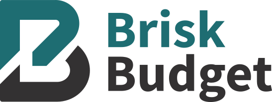
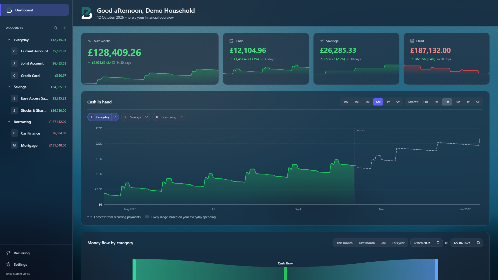

<p align="center">
  
</p>

A lightweight, self-hosted personal finance tracker for household finances. No subscriptions, no cloud, no database: just your money, on your server.



## Quick Deploy (Ubuntu / Debian)

Install with a single command:

```bash
curl -fsSL https://raw.githubusercontent.com/CoppingEthan/Brisk-Budget/main/deploy.sh | sudo bash
```

The script will:
- Install Node.js (if it's missing or older than version 20) and git
- Clone Brisk Budget to `/opt/brisk-budget`
- Set it up as a systemd service that starts on boot
- Start it at `http://localhost:3000` (or your server's address on your network)

To use a different port, run `PORT=8080` before the command: `curl ... | sudo PORT=8080 bash`.

### Updating

Run the same command again. Updating is safe:
- Brisk Budget is stopped and your data folder is backed up before anything changes
- Data from older versions is upgraded automatically (with its own safety copy)
- If anything goes wrong, or the new version doesn't start, the previous version and its data are put back
- Your settings in `/etc/default/brisk-budget` are never touched

### Automatic updates

To have Brisk Budget check for a new version every night and install it:

```bash
curl -fsSL https://raw.githubusercontent.com/CoppingEthan/Brisk-Budget/main/deploy.sh | sudo bash -s -- --auto-update
```

Turn it off again with `--no-auto-update`. A version that fails to start is rolled back and skipped until a newer one comes out. Settings › About shows whether automatic updates are on and whether a newer version is available.

## Manual Deploy

1. Clone the repository
2. Install dependencies: `npm install --omit=dev`
3. Start the server: `npm start`
4. Open your browser to `http://localhost:3000`

Requires Node.js 20 or newer.

## Features

- **Accounts** - Bank, savings, credit cards, loans, mortgages, investments and assets, in drag-and-drop groups. Liabilities are entered as the amount you owe.
- **Transactions** - Search, filter by category, date or direction, running balances, bulk categorise and delete with undo.
- **Transfers** - Linked transfers that stay in sync from either side. Turn an existing pair of imported transactions into a transfer without creating duplicates.
- **Recurring payments** - A calendar of what's due, monthly totals, and one-click logging (or let them log themselves on the due date). Brisk Budget suggests recurring payments it spots in your history.
- **Mortgages** - Interest is added each month on the remaining balance, with equity shown against the property value.
- **Investments and assets** - Give them a current value, which counts towards your net worth in place of the money paid in.
- **Dashboard** - Net worth, cash, savings and debt with their 90-day trends (choose one to chart it), a balance chart with a forecast and a likely range, and a money flow diagram.
- **CSV import** - Works with exports from UK banks, including separate paid in/paid out columns. Spots duplicates, maps categories and remembers your choices per account.
- **Backups** - Download a backup any time, automatic hourly backups, and restore from the app. Backups from older versions upgrade automatically.
- **Data check** - Finds and fixes problems such as transfers missing their other side.
- **Optional password** - Off by default; set one in Settings › Security.
- **Mobile friendly** - Works on phones and tablets, and installs as an app (PWA).

## Data Storage

All data is stored as plain JSON files in the `data/` folder, created on first run. No external database is required. Account icons are stored as image files in `data/icons/`.

Backups are kept in `backups/`: the last 24 hourly backups, plus safety copies taken before every upgrade and restore.

## Configuration

Most settings live in the app (Settings › General): your name, currency symbol and chart grouping.

These environment variables are optional. If you installed with the install command, put them in `/etc/default/brisk-budget` (one `NAME=value` per line), then run `sudo systemctl restart brisk-budget`:

| Variable | Default | Purpose |
| --- | --- | --- |
| `PORT` | `3000` | Port to listen on |
| `HOST` | all interfaces | Address to listen on, e.g. `127.0.0.1` behind a reverse proxy |
| `BRISK_DATA_DIR` | `./data` | Where data is stored |
| `BRISK_BACKUPS_DIR` | `./backups` | Where backups are stored |
| `BRISK_TRUST_PROXY` | off | Set to `1` behind a reverse proxy, so sign-in limits apply per visitor |
| `BRISK_ALLOWED_HOSTS` | none | Extra web addresses Brisk Budget answers to without a password, e.g. `budget.example.com, *.home.example.com` (see Security) |
| `TZ` | the server's | Time zone for "today", e.g. `Europe/London`. Worth setting if your server runs on UTC |
| `BRISK_UPDATE_CHECK` | on | Set to `0` to never contact GitHub for update checks |

## Security

Without a password, anyone who can reach Brisk Budget on your network can use it. Set a password in Settings › Security if other people share your network, and put Brisk Budget behind HTTPS (for example a reverse proxy) before exposing it to the internet.

Without a password, Brisk Budget only answers to its IP address, `localhost` and local network names (such as `raspberrypi`, `budget.local`, `nas.lan` or `*.home.arpa`). This stops other websites from reaching it through your browser. If you open it by your own domain name, either set a password or add the name to `BRISK_ALLOWED_HOSTS`. A reverse proxy on the same machine works without either.

Forgotten your password? Delete `data/auth.json` on the server and restart Brisk Budget.

## Development

```bash
npm install
npm run dev                 # restarts on server changes
npm test                    # server and logic tests
npx playwright install chromium
npm run test:e2e            # browser tests (they use their own demo data)
node scripts/seed-demo.js /tmp/brisk-demo/data   # a demo household to try things with
BRISK_DATA_DIR=/tmp/brisk-demo/data npm start
```

## Tech Stack

- **Backend:** Node.js native HTTP module
- **Frontend:** Vanilla JavaScript modules and CSS, no build step
- **Storage:** File-based JSON
- **Dependencies:** One (adm-zip)

## Why I Built This

Simply, I couldn't find a good alternative to Microsoft Money. Everything was either a paid subscription, missing key features or had terrible UX for the average person. I wanted something simple, self-hosted and easy to use.

## Development & AI Usage

This project was coded with LLM assistance. I provided the concepts, architecture, UX/UI design, and branding. AI wrote the code iteratively as I tested each component. I'm a designer, not a full-stack developer but I'm learning as I go.

## License

MIT License - see LICENSE file for details

## Author

Ethan Copping
